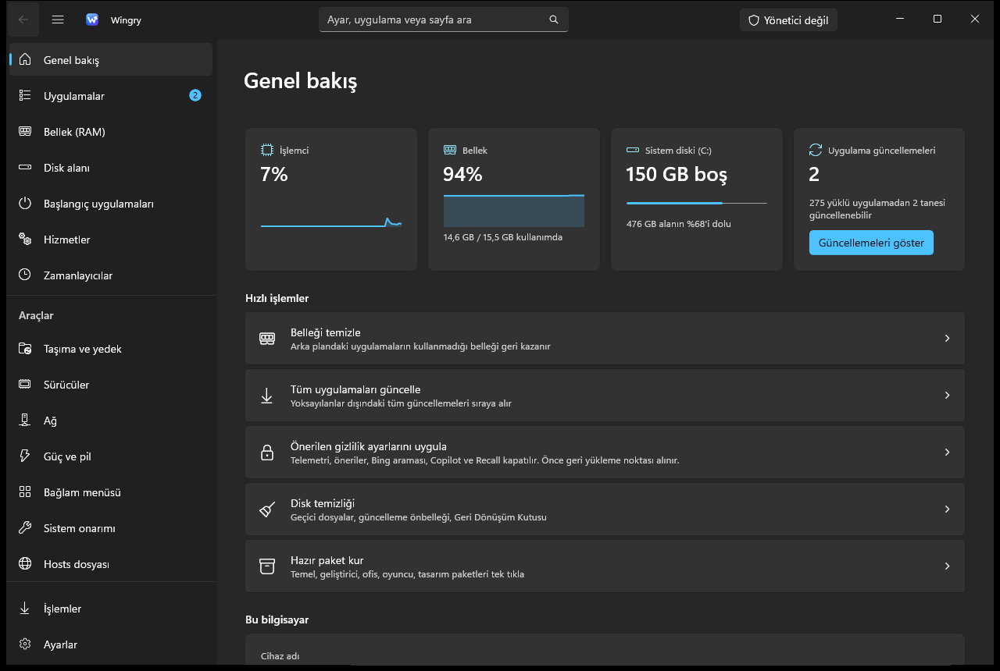
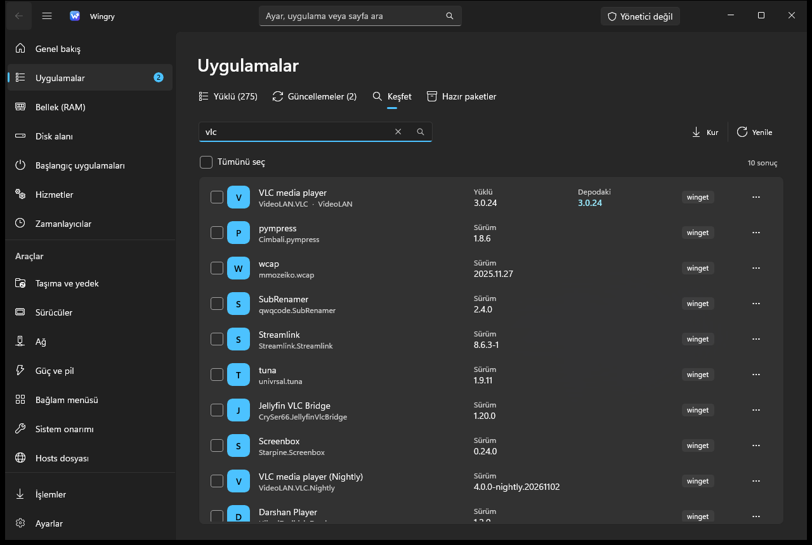
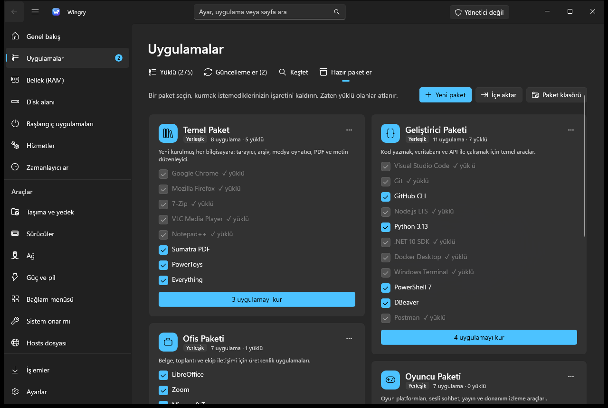
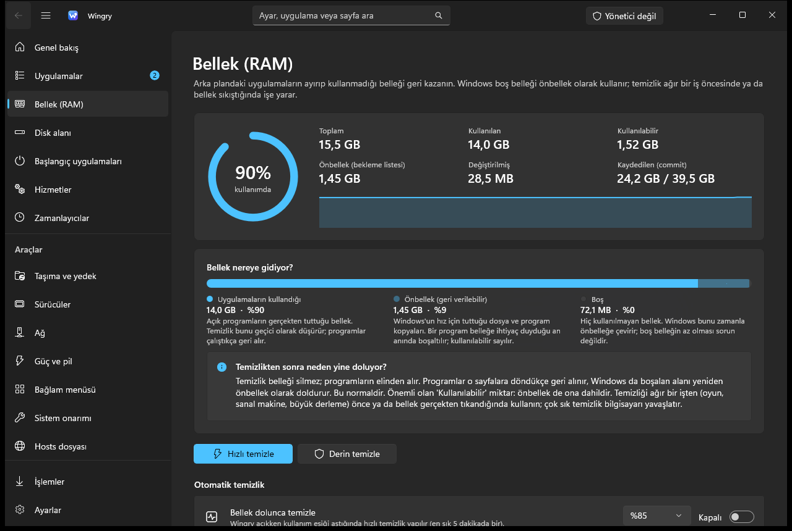
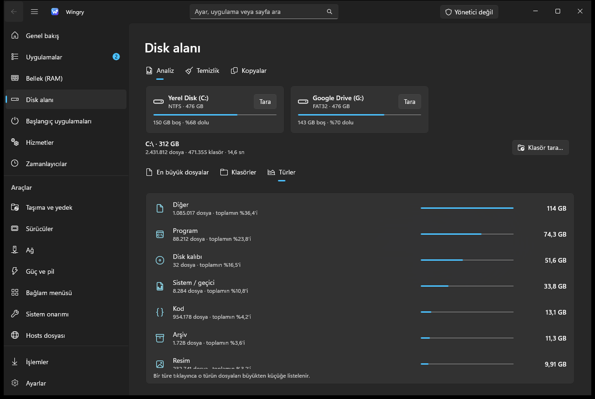
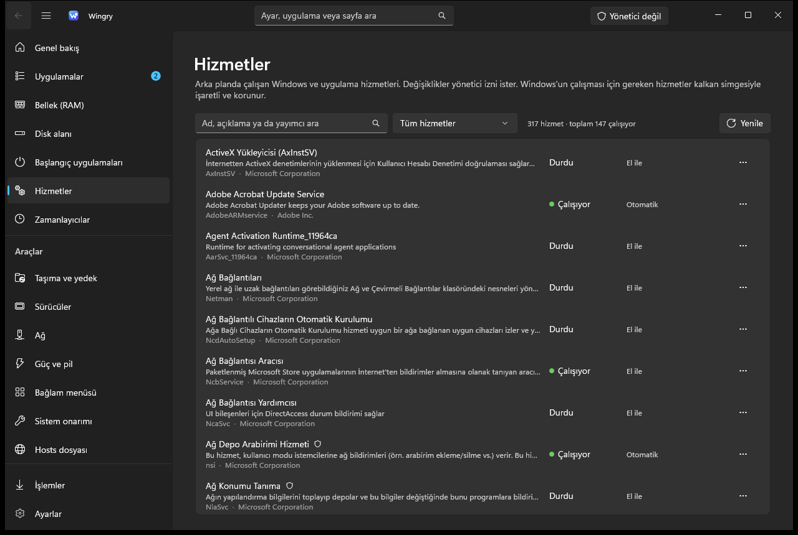
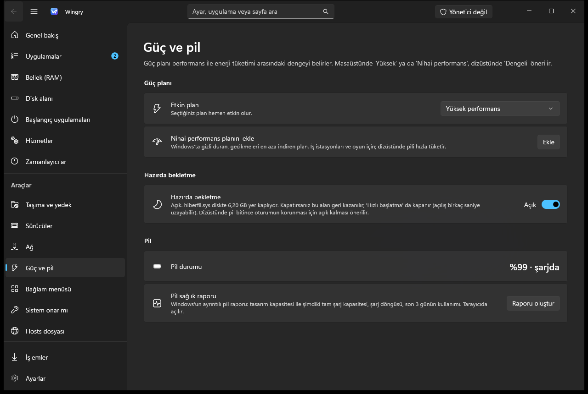

<div align="center">


# Wingry

**App management, system maintenance and privacy settings for Windows 11, in one window.**

Native WinUI 3 interface · install / update / remove apps with winget · RAM and disk tools · Win11Debloat tweaks

[](https://github.com/ynsmrtpc/wingry/releases/latest)
[](https://github.com/ynsmrtpc/wingry/releases)
[](LICENSE)


[**Download the latest release**](https://github.com/ynsmrtpc/wingry/releases/latest) · [Features](#features) · [Screenshots](#screenshots) · [Building](#building) · [Türkçe](README.tr.md)



</div>

> **Interface language:** the app's interface is currently in Turkish.

## Why Wingry?

- **Fast.** Written in C# / .NET 10 with WinUI 3; no Electron, no Python. The window opens in about 0.4 s,
  and scanning 275 installed apps for updates takes about 1.5 s.
- **Correct.** Uses winget's official COM API instead of parsing its text output, so it doesn't break on
  localized systems or long app names.
- **Looks like Windows 11.** Mica background, Fluent controls, light / dark theme, the same layout as the Settings app.
- **Safe.** Opens without administrator rights; tasks that need elevation are batched behind a single UAC prompt.
  A registry backup is taken before any setting changes, and a restore point can be created on request.

## Download and install

1. Download **Wingry.exe** from the [Releases](https://github.com/ynsmrtpc/wingry/releases/latest) page.
2. Double-click it. There is no installer: on first launch it unpacks itself to `%LOCALAPPDATA%\Wingry` (about 5 s); later launches are instant.
3. New versions install with one click from **Settings > Wingry update**.

**Requirements:** Windows 11 (also runs on Windows 10 1809+), x64. winget (App Installer) ships with Windows 11.
No .NET or other runtime needs to be installed.

## Features

### Apps
- **Installed / Updates / Discover:** search the winget repository; install, update or remove in bulk; ignore specific updates.
- **Silent installs:** one UAC prompt at the start of the queue, then every package installs in the background.
- **Ready-made bundles:** Essentials, Developer, Office, Gaming, Design and System tools; already installed apps are skipped.
- **Your own bundles:** build a bundle from selected apps, edit it, export / import it as `.json`.
  Files dropped into the **Paketler** folder next to `Wingry.exe` are listed automatically.
  `winget export` files are recognized as bundles too.

### System
- **Memory (RAM):** quick and deep cleanup, automatic cleanup above a threshold, and a breakdown of where memory goes.
- **Disk space:** parallel scanner (2.4 million files on C: in about 15 s), largest files first, type / size / date filters,
  folder tree, breakdown by file type, **duplicate finder** (size + SHA-256) and safe disk cleanup.
- **Startup apps** and **Services:** enable / disable in line with Task Manager; critical Windows services are protected.
- **Schedulers:** Windows tasks for RAM cleanup and app updates that run even while Wingry is closed.

### Tweaks (based on [Win11Debloat](https://github.com/Raphire/Win11Debloat))
Privacy and telemetry, AI (Copilot, Recall), Start menu and search, taskbar, File Explorer, appearance,
Windows Update, gaming, multitasking and optional features, each on its own page. Switches show the machine's
**current** state; changes are collected and applied in one go. Removing unwanted Store apps lives here too.

### Tools
- **Migration and backup:** save this PC's profile (apps, tweaks, startup preferences) to one file and
  import it on a new PC; only what's missing gets applied.
- **Drivers:** list them and back up third-party drivers to a folder.
- **Network:** per-connection DNS (Cloudflare, Google, Quad9, AdGuard), DNS cache, network reset, saved Wi-Fi passwords.
- **Power and battery:** power plans, Ultimate Performance plan, hibernation, battery health report.
- **Context menu:** hide / show right-click entries (reversible, no admin needed).
- **System repair:** disk health, DISM and SFC repair.
- **Hosts file:** editor and an ad / tracker blocklist.

The search box in the title bar searches pages, tweaks and the winget repository at once.

## Screenshots

| | |
|---|---|
|  |  |
| **Apps:** search the winget repository, installed vs. available version | **Bundles:** one-click install, installed apps are skipped |
|  |  |
| **Tweaks:** switches read the real state, with recommended and admin badges | **Memory:** cleanup and where your memory goes |
|  |  |
| **Disk space:** 2.4 million files in 15 s, breakdown by type | **Services:** search, filter, start / stop, startup type |
|  | |
| **Power and battery:** power plan, hibernation, battery report | |

## How administrator rights are used

The interface runs **without** administrator rights. Tasks that need them (system-wide settings, services, DISM,
deep RAM cleanup, silent installs) are collected and run as `Wingry.exe --worker` behind **a single UAC prompt**.
The "Not administrator" button in the title bar restarts the app elevated.

## Building

Requires the **.NET 10 SDK** (Windows).

```powershell
.\build.ps1                    # dist\Wingry.exe: single file, double-click to run
.\build.ps1 -Surum 1.1.0       # with a version number
.\build.ps1 -Klasor            # dist\Wingry-win-x64\ + zip (folder with DLLs)
```

During development: `dotnet build src\Wingry -c Debug`.

<details>
<summary><b>Technical notes</b></summary>

- **The single file is a launcher:** the app folder is embedded in the exe as a zip and unpacked to
  `%LOCALAPPDATA%\Wingry\uygulama` on first launch. The app itself can't be published as a .NET single file:
  the winget COM server rejects calls from a single-file host with `0x80073D54`.
- **Trimming (PublishTrimmed) is off:** it breaks the WinUI / COM projections.
- **Unpackaged WinUI publishing needs `EnableMsixTooling=true`;** otherwise `Wingry.pri` isn't copied.
- **Tweaks:** Win11Debloat's `.reg` files are applied with our own parser instead of `reg.exe`; the same parser
  reads each setting's current state. HKCU is written by the app process, HKLM by the elevated worker.

**Command line**

| Argument | What it does |
|---|---|
| `--sayfa <name>` | Open on a given page: `dashboard`, `apps`, `memory`, `disk`, `startup`, `services`, `settings`, `tweak:AI`… |
| `--baslangic` | Used at sign-in; optionally starts minimized |
| `--task ram [--deep]` | Headless RAM cleanup (scheduled task) |
| `--task update [--notify]` | Headless update, or notify only |
| `--task profil <file.json>` | Exports this PC's profile (for scripted backups) |

**Publishing a release:** run `.\build.ps1 -Surum X.Y.Z`, then create a GitHub Release tagged **vX.Y.Z** and attach
`dist\Wingry.exe` **with exactly that name**. The app checks the latest Release and shows its description as release notes.

**User data:** `%LOCALAPPDATA%\Wingry\` (`ayarlar.json`, `Yedekler\`, `Gunluk\`, `Paketlerim\`).

</details>

## Known limitations

- Not yet covered from Win11Debloat: Store search suggestions, Start menu for all users, forced Edge removal, Sysprep mode.
- Disk scanning lists directories (no MFT reading like WizTree); inaccessible folders are skipped and their count is shown.
- Some installers open their own window even in silent mode.

## Contributing

Bug reports and ideas are welcome in [Issues](https://github.com/ynsmrtpc/wingry/issues); questions and suggestions
fit [Discussions](https://github.com/ynsmrtpc/wingry/discussions). Pull requests are welcome too.

## License and credits

Wingry is released under the [MIT License](LICENSE).

- Tweak and bloatware definitions: [Win11Debloat](https://github.com/Raphire/Win11Debloat), © Raphire, MIT,
  see `src/Wingry/Data/Win11Debloat/LICENSE.txt`
- UI components: Windows Community Toolkit, MIT
- Ad blocking list: [StevenBlack/hosts](https://github.com/StevenBlack/hosts) (optional, downloaded from within the app)

The previous PyQt version (Wingy) lives at the [`v0-python`](https://github.com/ynsmrtpc/wingry/tree/v0-python) tag.
