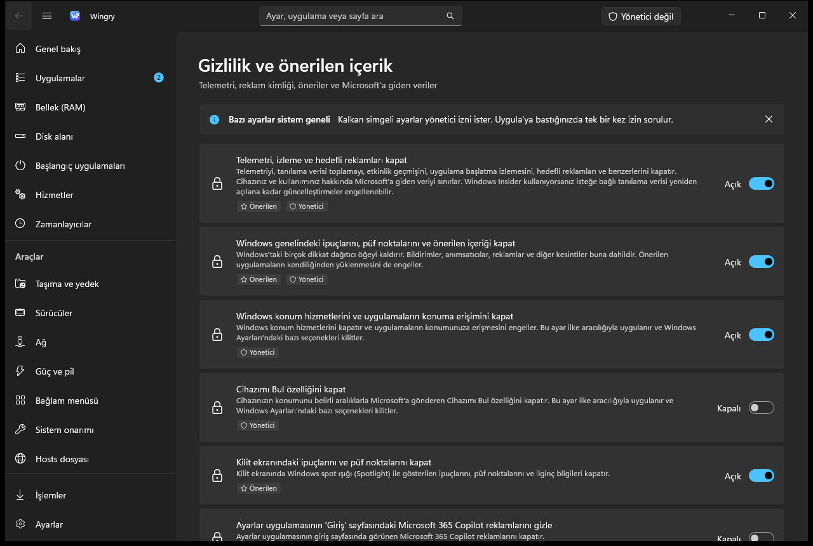

<div align="center">


# Wingry

**Windows 11 için uygulama yönetimi, sistem bakımı ve gizlilik ayarları — tek pencerede.**

Yerel WinUI 3 arayüzü · winget ile kur / güncelle / kaldır · RAM ve disk araçları · Win11Debloat ince ayarları

[**İndir (son sürüm)**](https://github.com/ynsmrtpc/wingry/releases/latest) · [Özellikler](#özellikler) · [Ekran görüntüleri](#ekran-görüntüleri) · [Derleme](#derleme)


</div>

## Neden Wingry?

- **Hızlı.** C# / .NET 10 ve WinUI 3 ile yazıldı; Electron ya da Python taşımaz. Pencere ~0,4 sn'de açılır,
  275 yüklü uygulama ve güncelleme taraması ~1,5 sn sürer.
- **Doğru.** winget'in metin çıktısını ayrıştırmak yerine resmî COM API'sini kullanır; Türkçe sistemde ya da
  uzun uygulama adlarında bozulmaz.
- **Windows 11'in kendisi gibi görünür.** Mica arka plan, Fluent denetimler, açık / koyu tema, Ayarlar uygulamasıyla aynı düzen.
- **Güvenli.** Yönetici izni gerektirmeden açılır; yönetici gerektiren işler tek bir UAC onayıyla toplu yapılır.
  Ayar değiştirmeden önce kayıt defteri yedeği alınır, isteğe bağlı geri yükleme noktası oluşturulur.

## İndirme ve kurulum

1. [Releases](https://github.com/ynsmrtpc/wingry/releases/latest) sayfasından **Wingry.exe**'yi indirin.
2. Çift tıklayın. Kurulum yok; ilk açılışta kendini `%LOCALAPPDATA%\Wingry` altına açar (~5 sn), sonraki açılışlar anında.
3. Yeni sürümler **Ayarlar > Wingry güncellemesi**'nden tek tıkla yüklenir.

**Gereksinimler:** Windows 11 (Windows 10 1809+ da çalışır), x64. winget (App Installer) Windows 11'de hazır gelir.
.NET ya da başka bir çalışma zamanı kurmanız gerekmez.

## Özellikler

### Uygulamalar
- **Yüklü / Güncellemeler / Keşfet:** winget deposunda arama, toplu kur · güncelle · kaldır, güncelleme yoksayma.
- **Sessiz kurulum:** Kuyruk başında tek UAC onayı, sonra tüm paketler arka planda kurulur.
- **Hazır paketler:** Temel, Geliştirici, Ofis, Oyuncu, Tasarım, Sistem araçları; yüklü olanlar atlanır.
- **Kendi paketlerin:** Seçili uygulamalardan paket oluştur, düzenle, `.json` olarak dışa / içe aktar.
  `Wingry.exe`'nin yanındaki **Paketler** klasörüne bırakılan dosyalar kendiliğinden listelenir.
  `winget export` dosyaları da paket olarak tanınır.

### Sistem
- **Bellek (RAM):** Hızlı ve derin temizlik, eşik aşılınca otomatik temizlik, belleğin nereye gittiğini gösteren döküm.
- **Disk alanı:** Paralel tarayıcı (2,4 milyon dosyalık C: ~15 sn), en büyükten küçüğe dosyalar, tür / boyut / tarih süzgeçleri,
  klasör ağacı, türlere göre dağılım, **kopya dosya bulucu** (boyut + SHA-256), güvenli disk temizliği.
- **Başlangıç uygulamaları** ve **Hizmetler:** Görev Yöneticisi ile uyumlu açma / kapama; kritik Windows hizmetleri korunur.
- **Zamanlayıcılar:** RAM temizliği ve uygulama güncellemesi için Wingry kapalıyken de çalışan Windows görevleri.

### İnce ayarlar ([Win11Debloat](https://github.com/Raphire/Win11Debloat) tanımlarıyla)
Gizlilik ve telemetri, Yapay zekâ (Copilot, Recall), Başlat menüsü ve arama, Görev çubuğu, Dosya Gezgini, Görünüm,
Windows Update, Oyun, Çoklu görev, İsteğe bağlı özellikler — her kategori ayrı sayfada. Anahtarlar bilgisayarın
**şu anki** durumunu gösterir; değişiklikler toplanıp tek seferde uygulanır. Gereksiz Store uygulamalarını kaldırma da burada.

### Araçlar
- **Taşıma ve yedek:** Bu bilgisayarın profilini (uygulamalar, ince ayarlar, başlangıç tercihleri) tek dosyaya kaydet,
  yeni bilgisayarda içe aktar; yalnızca eksikler uygulanır.
- **Sürücüler:** Liste, üçüncü taraf sürücüleri klasöre yedekleme.
- **Ağ:** Bağlantı başına DNS seçimi (Cloudflare, Google, Quad9, AdGuard), DNS önbelleği, ağ sıfırlama, kayıtlı Wi-Fi şifreleri.
- **Güç ve pil:** Güç planı, Nihai performans planı, hazırda bekletme, pil sağlık raporu.
- **Bağlam menüsü:** Sağ tık girdilerini gizle / göster (geri alınabilir, yönetici gerekmez).
- **Sistem onarımı:** Disk sağlığı, DISM ve SFC onarımı.
- **Hosts dosyası:** Düzenleyici ve reklam / izleyici engelleme listesi.

Başlık çubuğundaki arama kutusu sayfaları, ince ayarları ve winget deposunu birlikte arar.

## Ekran görüntüleri

| | |
|---|---|
|  |  |
| **Uygulamalar** — winget deposunda arama, yüklü sürüm ve depodaki sürüm | **Hazır paketler** — tek tıkla kurulum, yüklü olanlar atlanır |
|  |  |
| **İnce ayarlar** — gerçek durumu okunan anahtarlar, önerilen ve yönetici rozetleri | **Bellek** — temizlik ve belleğin nereye gittiği |
|  |  |
| **Disk alanı** — 2,4 milyon dosya 15 sn'de, türlere göre dağılım | **Hizmetler** — arama, süzme, başlat / durdur, başlangıç türü |
|  | |
| **Güç ve pil** — güç planı, hazırda bekletme, pil raporu | |

## Yönetici izni nasıl kullanılır?

Arayüz **yönetici olmadan** çalışır. Yönetici gerektiren işler (sistem geneli ayarlar, hizmetler, DISM,
derin RAM temizliği, sessiz kurulumlar) toplanır ve **tek bir UAC onayıyla** `Wingry.exe --worker` olarak
çalıştırılır. Başlık çubuğundaki "Yönetici değil" düğmesi uygulamayı yönetici olarak yeniden başlatır.

## Derleme

Gereken: **.NET 10 SDK** (Windows).

```powershell
.\build.ps1                    # dist\Wingry.exe — tek dosya, çift tıklayınca açılır
.\build.ps1 -Surum 1.1.0       # sürüm numarasıyla
.\build.ps1 -Klasor            # dist\Wingry-win-x64\ + zip (DLL'li klasör)
```

Geliştirirken: `dotnet build src\Wingry -c Debug`.

<details>
<summary><b>Teknik notlar</b></summary>

- **Tek dosya bir başlatıcıdır:** Uygulama klasörü exe'nin içine zip olarak gömülüdür, ilk açılışta
  `%LOCALAPPDATA%\Wingry\uygulama` altına açılır. Uygulamanın kendisi .NET tek dosya olarak paketlenemiyor:
  winget COM sunucusu tek dosya ana makinesinden gelen çağrıları `0x80073D54` ile reddediyor.
- **Kırpma (PublishTrimmed) kapalı:** WinUI / COM projeksiyonlarını bozuyor.
- **Paketsiz WinUI yayınında `EnableMsixTooling=true` şart;** yoksa `Wingry.pri` kopyalanmaz.
- **İnce ayarlar:** Win11Debloat'ın `.reg` dosyaları `reg.exe` olmadan kendi ayrıştırıcımızla uygulanır; aynı ayrıştırıcı
  her ayarın şu anki durumunu okur. HKCU uygulama sürecinde, HKLM yönetici işçisinde yazılır.

**Komut satırı**

| Parametre | İş |
|---|---|
| `--sayfa <ad>` | Belirli sayfayla aç: `dashboard`, `apps`, `memory`, `disk`, `startup`, `services`, `settings`, `tweak:AI`… |
| `--baslangic` | Oturum açılışında kullanılır; isteğe göre simge durumunda açar |
| `--task ram [--deep]` | Arayüzsüz RAM temizliği (zamanlanmış görev) |
| `--task update [--notify]` | Arayüzsüz güncelleme ya da yalnızca bildirim |
| `--task profil <dosya.json>` | Bu bilgisayarın profilini dışa aktarır (betiklerle yedekleme) |

**Yeni sürüm yayımlama:** `.\build.ps1 -Surum X.Y.Z` → GitHub'da **vX.Y.Z** etiketiyle Release açıp `dist\Wingry.exe`'yi
**tam bu adla** ekleyin. Uygulama en son Release'e bakar; Release açıklaması sürüm notu olarak görünür.

**Kullanıcı verisi:** `%LOCALAPPDATA%\Wingry\` (`ayarlar.json`, `Yedekler\`, `Gunluk\`, `Paketlerim\`).

</details>

## Bilinen sınırlar

- Win11Debloat'ın şu özellikleri yok: Store arama önerileri, tüm kullanıcılar için Başlat menüsü, Edge'i zorla kaldırma, Sysprep kipi.
- Disk taraması dizin listeleme ile yapılır (WizTree gibi MFT okuması yok); erişilemeyen klasörler sayılmaz ve sayısı gösterilir.
- Bazı kurulum programları sessiz kipte bile kendi penceresini açar.

## Teşekkür ve lisanslar

- İnce ayar ve gereksiz uygulama tanımları: [Win11Debloat](https://github.com/Raphire/Win11Debloat), © Raphire, MIT —
  `src/Wingry/Data/Win11Debloat/LICENSE.txt`
- Arayüz bileşenleri: Windows Community Toolkit, MIT
- Reklam engelleme listesi: [StevenBlack/hosts](https://github.com/StevenBlack/hosts) (isteğe bağlı, uygulama içinden indirilir)

Önceki PyQt sürümü (Wingy) [`v0-python`](https://github.com/ynsmrtpc/wingry/tree/v0-python) etiketinde duruyor.
